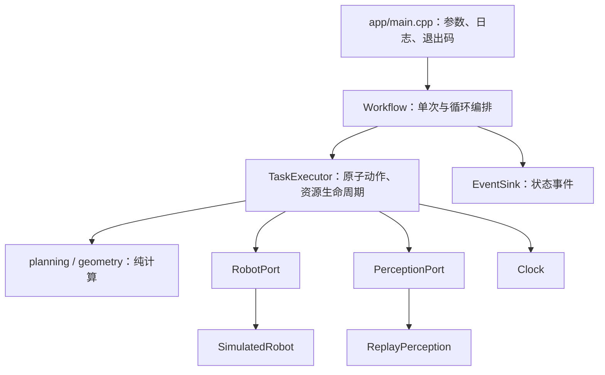

# 结构与扩展约定

当前交付范围是本机 C++ 核心、离线回放及模拟执行。主程序不链接 Galbot SDK，不加载 YOLO/FoundationPose，也没有连接机器人、使能、控制器切换等命令入口。

## 模块依赖



`robmove::core` 只依赖 Eigen、JSON 配置解析和标准库线程设施。`robmove::adapters` 提供离线实现。新硬件或新推理后端依赖应只加入适配层，不能让领域数据结构包含 SDK 类型、Torch Tensor 或 OpenCV Mat。

## 数据与计算约定

- `Pose` 使用 Eigen 定长向量、四元数；外部数组顺序固定为 `[x,y,z,qx,qy,qz,qw]`。不要把 Eigen 构造器的 `w,x,y,z` 顺序用于序列化。
- 位置、深度、宽度采用米；关节采用弧度；配置中的 `*_deg` 为角度；时间采用秒。
- `Candidate.object_pose` 是 `base_link <- object`。未来感知适配器负责 RGB-D 配对、内参、时间戳和相机到 base_link 的变换。
- 候选优先级保持原算法：x 越小越优先；右臂 y 越小越优先，左臂相反；最后比较置信度。可选 `ranking_position` 保存配准前 RGB-D 质心，避免误把模型原点当作原流程排序点。
- `select_candidate` 单遍选择，不为只取第一个候选排序整个列表。`robust_depth` 使用调用方复用的缓冲区及 `nth_element`，过滤不在 `(0.05,2.0)` 米的深度。
- FoundationPose 抓取规划保持原算法的侧向接近、左右臂工作角镜像、倒伏判定与 Gram–Schmidt 正交化。`plan_horizontal` 保留原独立 YOLO 示例的点位规划数学；当前 CLI 使用 FoundationPose 位姿规划。
- 原始 CAD 模型、训练权重及其哈希保持不变。未在本次迁移中导出 ONNX/TensorRT 模型。

## 任务与资源

`Workflow` 持有一份配置，每个实例仅执行一次。端口对象必须比 Workflow 活得更久；各对象在单线程中使用，不承诺并发调用安全。

`TaskExecutor` 统一执行初始化、归位、抓取、抬升、放置、导航、停止与关闭。初始化开始即记录清理责任，部分初始化失败仍调用清理。流程成功、失败、异常或取消后都会关闭已启动资源。析构只清理资源，不发归位或开爪命令。

单次流程：

```text
归位 → 加载感知 → 重试感知 → 开爪 → pre_grasp → grasp
→ 非阻塞闭爪 + 连续反馈确认 → lift → grasp 处释放 → pre_grasp → 归位
```

循环流程：

```text
导航到抓取点 → 归位 → 加载感知 → 感知
→ 抓取 → lift → lift_safe → 携物归位 → 导航到放置点
→ lift_safe → lift 处释放 → lift_safe → 归位 → 返回抓取点
```

循环中仅对 `Unavailable` 重试；有效空场单独累计，发现目标后清零。连续有效空场达到阈值后返回原点。达到 `max_cycles` 时完成释放、退让与归位后进入 HOLD，保持原流程语义。导航每次调用和尝试次数均有独立预算。

`Custody` 区分 `Empty`、`PossiblyHolding`、`Holding`。闭爪命令开始后即进入可能持物状态，只有连续夹持力与宽度反馈合格才能变为 Holding。空读、非有限值或宽度突变会打断连续确认。超时后返回的反馈不能授权抬升。HOLD 后不会自动松爪、归位或继续后续动作。

取消在动作边界和等待期间检查；等待最长每 50 ms 检查一次。阻塞适配器调用期间不能强行中断第三方库，实际取消延迟由该适配器的调用超时决定。真实适配器的 `observe()`、`load()`、状态读取及关闭必须自行设置有限超时，当前核心无法替代设备侧急停或安全控制。

## 接入真实设备

设备 SDK 版本尚未确认；源码里的“SDK 1.9.0”注释只说明原作者参考过该版本，不能视为实际安装版本。本次没有写未经版本核对的 Galbot C++ 调用。

官方资料查询已确认 G1 有 C++ `GalbotRobot::init` 接口；例如 [G1 SDK 1.9.0 C++ 参考](https://developer.galbot.com/docs/SDK/1.9.0/g1/zh/api_cpp_reference) 与 [1.10.0 C++ 参考](https://developer.galbot.com/docs/SDK/1.10.0/g1/zh/api_cpp_reference)。这些链接是接口存在的文档依据，不是设备版本或实机兼容性验证。

版本确认后，在独立适配器中实现 `RobotPort`：

1. 核对安装库、头文件、机型、运行位置和精确版本，先完成有限次数的只读状态读取。
2. 将 SDK 的初始化返回值、运动结果和异常映射为端口约定。运动返回 `false` 时必须已经停止执行，不能把 SDK 的 IN_PROGRESS 当成失败返回后立即重试。
3. 导航适配器负责定位/可达性检查、到达确认及配置恢复。`lock_heading` 是请求，不能声称刚性锁定朝向，也不能遗留导航速度设置。
4. `stop()` 停止底盘与机械臂轨迹；`shutdown()` 幂等、无抛出，仅释放本适配器持有的资源，不自动松爪。
5. 先通过同一套离线接口测试，再按用户的机器人运动授权与现场安全条件安排实测。

感知接入实现 `PerceptionPort`：加载并复用分割/位姿模型，采集新帧，验证深度与变换，区分有效空场和链路故障，返回统一 `Observation`。未来可使用原 Python 推理服务、原生推理库或其他后端，但这些实现不包含在当前交付中。

## 配置与日志

`config/default.json` 给出运行参数；可省略的字段使用 `Config` 默认值。未知字段、重复 JSON key、错误类型、非有限数、无效四元数、错误机械臂/夹爪组合和缺失导航位姿会在启动阶段拒绝。

`perception.objects` 和 `perception.aliases` 按 key 合并默认目录；添加新物料时提供 CAD 路径、物体坐标系抓取点和两个偏移。默认五类物料在 `config.hpp` 中定义。`resource_root` 相对配置文件目录解析；模型/CAD 路径再相对该目录解析。离线配置检查只验证结构与数值，不验证推理依赖或模型兼容性。

CLI 的 `--json` 输出 JSON Lines 状态事件和最终摘要。`--trace` 保存模拟指令、位姿及开爪宽度。核心只依赖 `EventSink`，可以替换为结构化文件日志、监控或界面。没有全局可变配置或导入时日志副作用。
