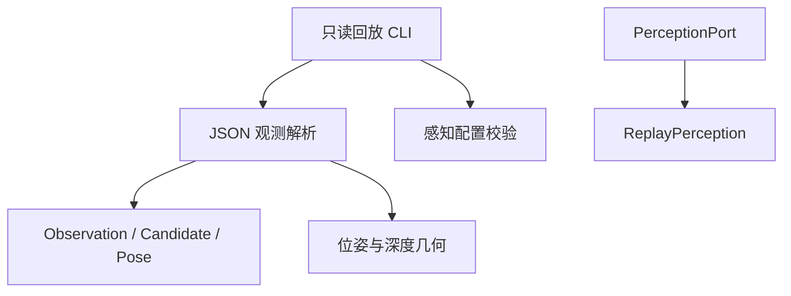

# 感知模块结构

0.2.0 的 C++ 核心只包含感知数据、几何计算、配置校验和离线回放。

## 数据约定

- `Pose` 是三维位置与单位四元数。序列化顺序为 `[x,y,z,qx,qy,qz,qw]`，位置和物体宽度使用米。
- `Candidate.object_pose` 表示 `base_link <- object`。`ranking_position` 可保存配准前观测到的 RGB-D 质心，仅作为感知数据。
- `Observation` 区分 `Found`、`Empty`、`Unavailable`。只有 `Found` 包含候选；无效深度或数据源结束不等同于有效空场。
- `back_project`、`transform_point`、`robust_depth` 只处理坐标和深度数据。

## 接口与生命周期

`PerceptionPort` 只提供 `load()`、`observe()`、`shutdown()`。回放适配器首次加载文件后顺序输出观测；读取结束返回 `Unavailable`，关闭操作可重复调用。

命令行直接解析有限帧列表并逐帧输出，不运行控制循环。JSON 输入采用严格类型和重复字段检查，错误包含输入文件位置或字段信息。

## 感知配置

`Config` 仅包含 `PerceptionConfig`。物料定义包含 CAD 路径，类别别名必须指向已配置物料。模型路径、缩放比例、置信度和深度采样半径均会校验。配置不再接受机械臂、夹爪、任务或导航字段。

C++ 核心依赖 Eigen；JSON 解析使用 nlohmann/json。公共接口不包含设备 SDK 类型、Torch Tensor 或 OpenCV Mat。

## Python 感知参考

`pick_place_pipeline/perception.py` 保留 YOLO 分割、FoundationPose 物体位姿估计和相机数据读取。候选按检测置信度排序，不再根据机械臂可达性选取目标。Python 配置文件可独立读取，不会导入设备 SDK。

相机适配代码仍需在确认实际机型、SDK 版本和运行位置后集成。当前保留的 SDK 调用用于相机、深度和坐标变换读取；本次修改未连接或运行机器人。VLM 可在后续通过独立感知适配器接入，当前没有 VLM 实现。
